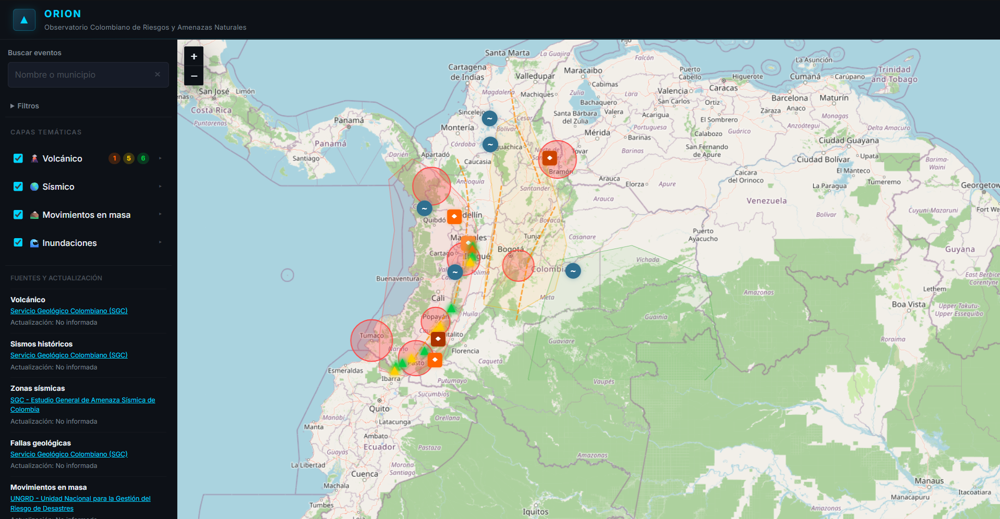

# 🌋 ORION
### Observatorio Colombiano de Riesgos y Amenazas Naturales

> *"Comprendiendo los riesgos del territorio colombiano"*

ORION es una plataforma web geográfica educativa e informativa para la visualización y consulta de amenazas naturales en Colombia, desarrollada con tecnologías SIG Web de código abierto.

---

##  Vista general



ORION integra en un solo visor interactivo información sobre las principales amenazas naturales del territorio colombiano, permitiendo a estudiantes, investigadores y ciudadanos comprender de manera integrada los riesgos presentes en el país.

##  Módulos temáticos

| Módulo | Descripción | Fuente |
|--------|-------------|--------|
|  **Volcánico** | 12 volcanes activos con nivel de alerta, radio de influencia, historia eruptiva y observatorio de monitoreo | SGC |
|  **Sísmico** | Sismos históricos, zonas de amenaza sísmica y fallas geológicas principales | SGC |
|  **Movimientos en masa** | Eventos históricos de deslizamientos y avenidas torrenciales | UNGRD |
|  **Inundaciones** | Cuencas principales y áreas susceptibles a inundación | IDEAM |


##  Tecnologías utilizadas

- **HTML5 / CSS3 / JavaScript** — sin frameworks ni dependencias pesadas
- **[Leaflet.js](https://leafletjs.com/)** — librería de mapas interactivos
- **GeoJSON** — formato estándar para datos geoespaciales
- **OpenStreetMap / CartoDB** — capas base del mapa

---

##  Estructura del proyecto

```
orion/
├── index.html          # Página principal
├── css/
│   └── style.css       # Estilos de la plataforma
├── js/
│   └── app.js          # Lógica del visor cartográfico
└── data/
    ├── volcanes.geojson
    ├── sismos.geojson
    ├── zonas_sismicas.geojson
    ├── fallas.geojson
    ├── movimientos_masa.geojson
    └── inundaciones.geojson
```

##  Cómo usar

1. Clona el repositorio:
```bash
git clone https://github.com/juliancruz27/orion.git
```

2. Abre `index.html` en tu navegador — no requiere servidor ni instalación adicional.

> También puedes usar la extensión **Live Server** de VS Code para desarrollo local.

## Mapas base

El visor permite alternar entre mapas claro (predeterminado), oscuro, topográfico
y satelital desde el selector desplegable ubicado sobre la leyenda, en la esquina
inferior derecha. Los mapas base de Esri seleccionados no requieren API key; cada
proveedor conserva su atribución visible en el mapa.

## Actualización automática de sismos

La acción de GitHub [Validar y actualizar sismos SGC](.github/workflows/actualizar-datos-sgc.yml)
consulta semanalmente el servicio ArcGIS REST del SGC y también se puede ejecutar
manualmente desde la pestaña **Actions**. Conserva los sismos históricos curados,
incorpora los eventos recientes que superen las validaciones y registra la fecha
de actualización en `data/metadatos.json`. Si la fuente falla, no contiene datos
recientes, devuelve datos incompletos o excede el límite de consulta, la tarea no
reemplaza los archivos existentes.

**Limitación actual:** el servicio consultado es un catálogo histórico y su evento
más reciente disponible llega a 2020-12-30. Por tanto, la validación programada
no publicará datos nuevos hasta que el servicio ofrezca eventos dentro de los
últimos 30 días. No se debe interpretar este proceso como monitoreo en tiempo real.

 ## Fuentes de datos

- **[Servicio Geológico Colombiano (SGC)](https://www.sgc.gov.co)** — Volcanes, sismos y fallas geológicas
- **[UNGRD](https://portal.gestiondelriesgo.gov.co)** — Movimientos en masa y gestión del riesgo
- **[IDEAM](https://www.ideam.gov.co)** — Hidrología e inundaciones

---

##  Contexto académico

Proyecto desarrollado como parte de la formación en **Geografía** en la **Universidad del Cauca**. ORION está concebido como un módulo del sistema **ORBIS** — Plataforma Nacional de Inteligencia Territorial, actualmente en desarrollo.

---

 ##  Autor

**Julian Cruz** — Estudiante de Geografía, Universidad del Cauca  
GitHub: [@juliancruz27](https://github.com/juliancruz27)

---

*Plataforma educativa e informativa. No constituye un sistema de monitoreo en tiempo real ni una fuente oficial de alertas.*
